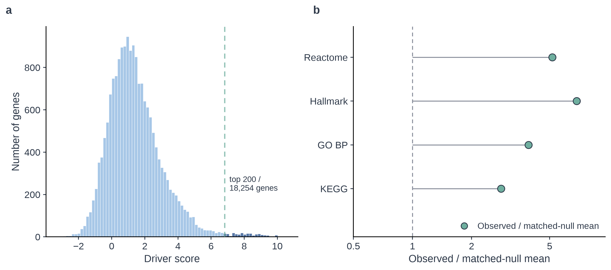
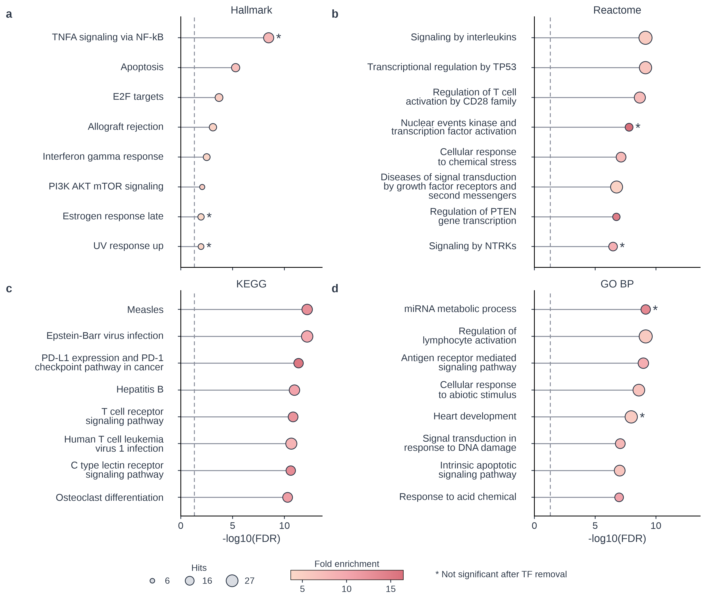
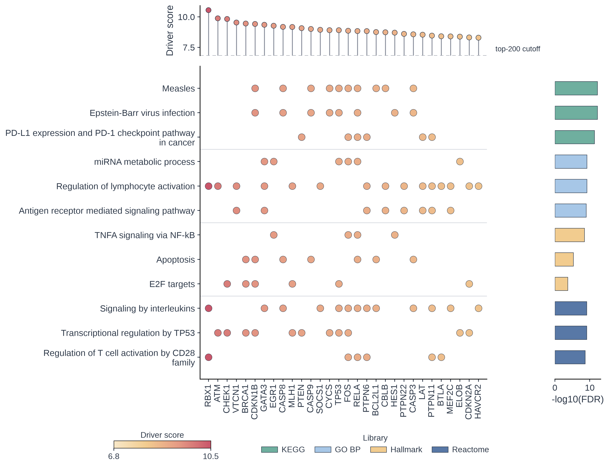
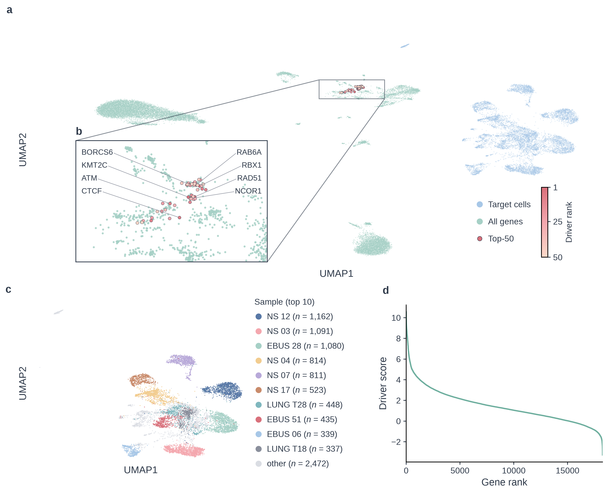
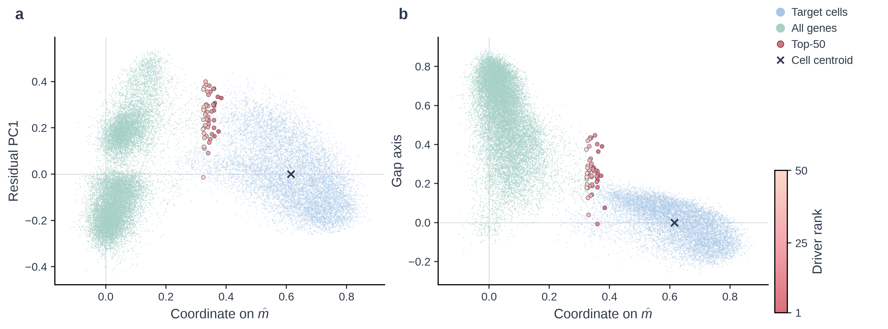

# 一、主要结果

## 1. 驱动基因排序与文献证据

在 GSE131907 的 LUAD 数据上，MARS 对 18,254 个候选基因给出连续的驱动得分，最高 10.55，前 200 名的得分下限为 6.82。表 1 列出高分基因、促癌/抑癌方向和主要证据。

**表 1｜高分基因及文献证据。** 排名和得分来自 `driver_gene_predictions.csv`，方向依据细胞、组织或动物实验文献。

| 排名 | 基因 | Driver score | 方向 | 主要证据 | 与 LUAD 的联系 |
|---:|---|---:|---|---|---|
| 1 | RBX1 | 10.549 | 促癌 | Signal Transduct Target Ther, 2026 | HSP90 稳定 ROC1；高表达者预后差，HSP90 抑制可抑制肿瘤生长 |
| 3 | RAD51 | 10.223 | 促癌 | Sci Rep, 2026；BBRC, 2022 | HR 修复；高表达致放疗抵抗 |
| 7 | RAB6A | 9.884 | 促癌 | J Clin Invest, 2021 | p53 缺失激活分泌通路，促侵袭 |
| 8 | ATM | 9.878 | 抑癌 | Br J Cancer, 2019 | 缺失对 PARP/ATR 抑制和放疗敏感 |
| 9 | RUNX1 | 9.877 | 促癌（NSCLC） | FASEB J, 2023 | 经 mTOR 促增殖和迁移 |
| 10 | NEDD8 | 9.877 | 促癌 | Cell Biol Toxicol, 2020 | 阻断 cullin neddylation，G2 阻滞/凋亡 |
| 12 | CHEK1 | 9.824 | 促癌 | Adv Sci, 2026 | MIF 促 M2 极化；SRA737 抑瘤 |
| 15 | STK11 | 9.661 | 抑癌 | Nature（TCGA）, 2014 | 17% 突变，PP 亚型，mTOR 激活 |
| 16 | SETD2 | 9.557 | 抑癌 | JCI Insight, 2023 | 加速 Kras 肺癌，H3K36me3 丢失 |
| 24 | NF1 | 9.342 | 抑癌 | EMBO Mol Med, 2019 | 加速 Kras 肺癌，Psat1 谷氨酰胺依赖 |

模型预测的前 10 名中，RBX1、RAD51、RAB6A、NEDD8 有 LUAD 促癌证据，ATM 为抑癌方向，RUNX1 的证据则来自 NSCLC 细胞系和混合队列，未按 LUAD 分层。未列入的 KMT2C（第 2 位）、BORCS6（第 5 位）无 LUAD 专属研究；NCOR1（第 4 位）、CTCF（第 6 位）仅有单篇、期刊影响力有限的报道。

关于 LUAD 较有影响力的文献中， TCGA LUAD（Nature, 2014）是 230 例肺腺癌的多组学图谱、CPTAC（Cell, 2020）是 110 例的蛋白基因组图谱；所研究的基因可作外部参考。STK11、SETD2、NF1 分别排在第 15、16、24 位，BRCA1、ARID1A、RB1、TP53 分别位于第 18、21、33、49 位。文献调研结果也显示，模型更偏向泛癌或细胞普遍依赖的基因，而非 LUAD 特有驱动。

## 2. 通路富集

我们把前 200 名基因放在 KEGG、GO、Hallmark 和 Reactome 四类通路库，同时用过表达分析（ORA）和排序富集分析（GSEA）检验。ORA 在 FDR<0.05 下得到 866 个显著通路，GSEA 在相同阈值下得到 2,307 个，两者共同显著的有 667 个。表 2 按库汇总。

**表 2｜各通路库的显著通路数。** ORA 与 GSEA 均以 FDR<0.05 为显著；GO 按 BP/CC/MF 三个子库分别统计。

| 通路库 | ORA 显著 | GSEA 显著 | 两者共同显著 |
|---|---:|---:|---:|
| KEGG | 114 | 177 | 105 |
| GO BP | 495 | 1,050 | 334 |
| GO CC | 19 | 201 | 14 |
| GO MF | 20 | 193 | 16 |
| Hallmark | 17 | 28 | 13 |
| Reactome | 201 | 658 | 185 |
| 合计 | 866 | 2,307 | 667 |

GSEA 使用全部基因的得分排序，不设截断，因此显著通路数明显多于 ORA；两者共同显著的 667 个通路更可信。显著通路主要集中在 GO BP 和 Reactome。图 2 和图 3 都使用 ORA 结果；GSEA 用于检验同一批基因在排序上是否同向。

**图 1｜驱动得分分布与富集强度的随机对照。** (a) 18,254 个候选基因的 Driver score 分布，虚线为前 200 名截断（6.82）。(b) KEGG、GO BP、Hallmark 和 Reactome 四个通路库中，前 200 名观察到的显著通路数除以按注释数量匹配的随机基因集均值；虚线为 1。

图 1 显示，前 200 名位于得分分布的长尾末端，与主体分离。前 200 名平均有 70.9 个通路注释，背景仅 28.6 个；注释多的基因更容易显著，是富集分析主要的假阳性来源。图 1b 按注释数匹配随机对照，四个库仍为预期的 2–6 倍（经验 p 0.001–0.044），扣除注释广度后富集仍然成立。

**图 2｜各通路库最显著的代表通路（ORA）。** 四个面板分别为 Hallmark、Reactome、KEGG 和 GO BP；横轴为 $-\log_{10}(\mathrm{FDR})$，点大小为命中基因数，颜色深浅表示 fold enrichment，星号表示剔除转录因子后不再显著。

图 2 的通路可以分为三类，可信度各不相同。第一类是 DNA 损伤应答、凋亡和细胞周期，代表通路为凋亡、E2F 靶基因、PI3K/AKT/mTOR 信号、内源性凋亡信号和 DNA 损伤应答；与 LUAD 驱动机制的关系最直接。第二类是免疫与检查点，代表通路为 PD-L1/PD-1 检查点、T 细胞受体信号、麻疹病毒感染、EB 病毒感染、乙型肝炎病毒感染、HTLV-1 感染、白细胞介素信号和 CD28 家族介导的 T 细胞激活；在肿瘤免疫微环境中合理，但部分由 T 细胞和免疫相关基因贡献。第三类是转录调控，代表为 TP53 转录调控、miRNA 代谢过程和肿瘤坏死因子 α/NF-κB 信号；与转录因子注释高度重叠。GSEA 在不设截断时给出与 ORA 一致的正向富集，细胞周期、DNA 复制和 E2F 最强。

前 200 名里有 61 个转录因子，随机情况下大约只有 15 个，富集 4.0 倍（p=7e-22）。我们把 GO 分子功能条目“DNA 结合转录因子活性”收录的 1,381 个基因作为转录因子集合，用超几何检验比较前 200 名和背景。去掉这些基因后，图 2 中带星号的免疫和转录激活类通路不再显著，但DNA 损伤、凋亡和细胞周期类仍然显著。因此，前 200 名的信号要分两种情况看：DNA 损伤、凋亡和细胞周期较稳健；免疫和转录调控有一部分是转录因子注释带来的假阳性。

**图 3｜代表通路与前 200 名基因的对应关系（ORA）。** 行为 12 个代表通路，列为至少命中两个通路的 Top-200 基因，按 Driver score 排序；点颜色为基因得分，右侧条形为通路的 $-\log_{10}(\mathrm{FDR})$。

图 3 列出支撑这些通路的高分基因：RBX1、ATM、CHEK1、BRCA1、CASP8、MLH1、PTEN、CASP9、TP53、RELA 等同时命中多个代表通路；免疫类通路由 RELA、PTPN6、LAT、BTLA、HAVCR2 等基因支撑。这些通路由同一组高分基因反复支撑，并非彼此独立。其中，RBX1、ATM、CHEK1 正是表 1 中有功能证据的高分基因，BRCA1、TP53 也出现在 TCGA/CPTAC 的公认驱动名单里。

## 3. 嵌入空间

MARS 把 9,512 个目标细胞的转变向量和 18,254 个基因向量映射到同一个 1,024 维单位球面；基因得分等于它与全部细胞转变向量平均方向的相似度乘以固定系数 44.64。图 4 是细胞和基因的联合 UMAP。

**图 4｜细胞与基因的联合 UMAP。** (a) 9,512 个目标细胞（蓝）与 18,254 个基因（绿）的联合 UMAP，Top-50 基因按排名着色。(b) Top-50 区域的放大图，标注前 8 个基因。(c) 仅细胞，按样本着色（按细胞数排序的前 10 个样本）。(d) 全部基因的 Driver score 随排名的变化。

图 4a 中细胞（蓝）和基因（绿）落在不同的岛，几乎不混合，符合对比学习模型常见的模态间隙。Top-50 基因（深珊瑚到浅桃色）在基因嵌入中形成一个紧密的小团（图 4b）。图 4c 只看细胞并按样本着色：细胞按患者/样本聚集，15 个最近邻中 86% 来自同一样本。转变嵌入保留了很强的样本特异信息，当前空间主要区分样本来源，而不是组织来源。

**图 5｜细胞与基因的线性投影。** 横轴为目标细胞质心方向（基因横坐标与得分成正比）；纵轴分别为残差 PC1（a）和基因均值与细胞均值之差的方向（b）。Top-50 基因按排名着色，叉号标记细胞质心。

图 5 把 27,766 个单位向量（9,512 个细胞加 18,254 个基因）投影到三个互相正交的方向上，不做 UMAP，因此坐标之间的关系是线性的。两子图的横轴是目标细胞质心的单位方向 $\hat{m}$。对基因而言，横轴正比于 Driver score （细胞则不具有此性质）。第二条轴由全部基因的均值向量减全部细胞的均值向量得到，对 $\hat{m}$ 正交化后作为图 5b 的纵轴，代表两个模态分开的方向。第三条轴是去掉前两个方向后剩余变异的第一主成分，作为图 5a 的纵轴，主要展开每团云内部的形状。

横轴上，细胞集中在 0.16–0.88（均值 0.62），基因在 −0.12–0.38（均值 0.05）。Top-50 基因位于 0.32–0.38，属所有基因中最靠右；随机基因与细胞的平均余弦相似度约 0.03，Top-50 为 0.20–0.24。

# 二、方法概述

## 2.1 数据与模型

分析基于 GSE131907 的 LUAD 单细胞数据，转变定义为正常上皮到恶性上皮，目标细胞 9,512 个，候选基因 18,254 个。MARS 用预训练 scGPT 编码源/目标细胞的转录组，转变层取两者嵌入之差；基因侧用 ESM 蛋白序列嵌入；两侧经对齐头映射到同一个 1,024 维单位球面。

## 2.2 文献核对

以排名前 20 的基因为主，检索 LUAD 专属的功能、预后和体内实验文献，记录促癌/抑癌方向；同时用 TCGA LUAD（Nature, 2014）和 CPTAC（Cell, 2020）两篇基准论文正文明确点名的基因回查预测排名。逐条证据保存在 `~/projects/luad_driver_gene/luad_gene_evidence.md`。

## 2.3 通路富集

18,254 个候选基因按 HGNC 统一符号，18,243 个成功映射（99.94%），以 18,195 个已映射基因作背景；前 200 名全部映射。ORA 对每条通路做单侧 Fisher 精确检验：

$$p = \sum_{k \ge h} \frac{\binom{K}{k}\binom{N-K}{n-k}}{\binom{N}{n}}$$

其中 $N = 18{,}195$ 为背景基因数，$K$ 为通路大小，$n = 200$ 为前 200 名，$h$ 为命中的前 200 名基因数；库内做 BH 校正，FDR<0.05 为显著，通路大小限制在 10–500 个基因，至少命中 3 个。GSEA 用全部基因按得分排序做 prerank，1,000 次置换，富集分数经 robust-z 变换；通路库为 KEGG、GO BP/CC/MF、Hallmark 和 Reactome。

转录因子集合取 GO 分子功能条目“DNA 结合转录因子活性”，背景中覆盖 1,381 个基因，用超几何检验比较前 200 名的命中数。稳健性检查包括前 100/200/300/500 名的阈值敏感性、raw/rank 得分变换、按注释数量匹配的 1,000 组随机基因集，以及剔除转录因子后的重跑。

## 2.4 嵌入可视化

取 9,512 个目标细胞转变向量和 18,254 个基因向量的合并矩阵 X（27,766 × 1,024），构造三个互相正交的方向：

$$\hat{m} = \frac{m}{\lVert m \rVert}, \quad g = \bar{x}_{\mathrm{gene}} - \bar{x}_{\mathrm{cell}}, \quad \hat{g} = \frac{g - (g \cdot \hat{m})\hat{m}}{\lVert g - (g \cdot \hat{m})\hat{m} \rVert}$$

$$r_i = x_i - (x_i \cdot \hat{m})\hat{m} - (x_i \cdot \hat{g})\hat{g}$$

$$\hat{p} = \mathrm{PC1}(\{r_i\})$$

并对 $\hat{m}$ 和 $\hat{g}$ 正交化。每个点 $i$ 的坐标为 $(x_i \cdot \hat{m},\ x_i \cdot \hat{g},\ x_i \cdot \hat{p})$。由于 $e_g \cdot \hat{m} = s_g/44.64$，基因在横轴上的坐标与得分严格成正比。

UMAP 在 PCA 50 维上计算（解释方差合计 0.591），余弦距离，n_neighbors = 30，min_dist = 0.3，random_state = 0。
